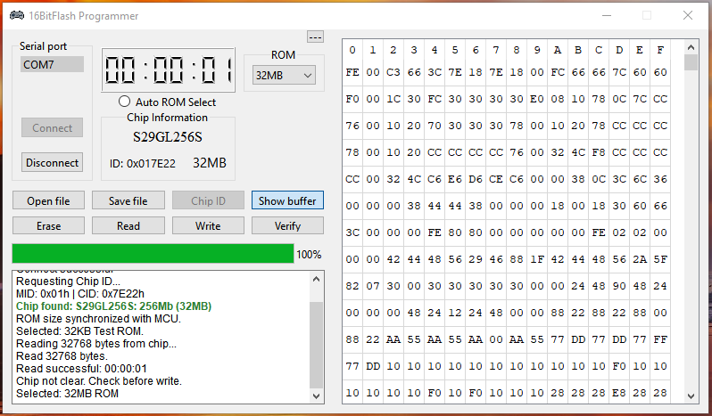

# 16BitFlash Programmer (SEGA Mega Drive / Genesis)

🌐 **Язык / Limbă:** [Русский](README.md) | Română

> 💡 **Istoria proiectului:** Proiectul a fost conceput inițial ca un experiment simplu pentru a studia funcționarea portului COM, a protocolului UART și a transmiterii de date între PC și dispozitive externe, dar s-a transformat într-un programator în toată regula.

Programator bazat pe microcontrolere **Raspberry Pi Pico (RP2040)** sau **Arduino Nano** și software de control în **Qt 6 C++** pentru **Citirea, Scrierea, Ștergerea și Verificarea** cipului de memorie Flash pe 16 biți (seriile **MX29LV, AM29F, ES29LV, HY29F, S29AL, S29GL** etc.) și a cartușelor **SEGA Mega Drive / Genesis**.

---

## 🚀 Noutăți în versiunea v3.1.1

* **Qt 6 GUI:** Adăugată posibilitatea de selectare și lucru cu imagini ROM de până la 32 MB în interfața programului.
* **Suport RP2040:** Adăugate noi schițe (firmware) pentru Raspberry Pi Pico cu suport pentru Sega Bank Switching (SSF2 Mapper).
* **Citire și scriere (SSF2):** Implementat suport stabil pentru citirea și scrierea imaginilor ROM de până la 32 MB prin mapper-ul SSF2 pe hardware fără a necesita lipire (este necesar un cartuș cu mapper încorporat).

---

## 🚀 Noutăți în versiunea v3.1.0

* **Actualizare interfață software (Qt GUI):** Interfață de utilizator îmbunătățită, gestionare optimizată a dimensiunilor ROM printr-o listă derulantă (QComboBox) și fereastră de informații despre proiect actualizată.
* **Trecerea la RP2040 (Raspberry Pi Pico):** Microcontroler pe 32 de biți ARM Cortex-M0+.
* **Optimizare protocol de transfer:** Aplicația pentru desktop este adaptată și optimizată pentru funcționarea la viteze mari cu **RP2040**.
* **Creșterea vitezei:** Timpul de scriere pentru **1 MB** este de **~5 minute** (pe RP2040) față de **~30 minute** (pe Arduino Nano). Scrierea dump-urilor mari de **15 MB** durează doar **~1 oră și 10 minute** în loc de **~8 ore și 20 minute**.
* **Placă cu circuite imprimate (PCB v3.0.0):** Placă dublu strat cu amprentă dublă (Pico + Nano), indicatoare LED pentru operațiuni și suport pentru expansoare rapide **MCP23S17 (SPI)** / **MCP23017 (I2C)**.

---

## 🖥 Interfață și funcționalități software (Qt GUI)

* **Monitorizare:** Cronometru LCD pentru operațiuni și fereastră pentru jurnalul de consolă.
* **Selectare capacitate:** Presetări de la 512 KB la 32 MB, `TEST 32KB` (verificare rapidă) și modul inteligent `Auto ROM Select`.
* **Vizualizator Hex:** Vizualizare integrată a dump-urilor de memorie pe 16 coloane (`Show buffer`).
* **Operațiuni principale:** Citire, Scriere, Ștergere, Verificare.

---

## 🌟 Caracteristici cheie

* **Auto ROM Select inteligent:** Detectează automat dimensiunea fișierului, dacă dimensiunea se potrivește cu una standard — selectează presetarea corespunzătoare, dacă nu — transmite microcontrolerului adresa finală exactă a fișierului de orice dimensiune. Pentru lucrul cu capacități de peste 4 MB (8 MB și 16 MB) este necesară lipirea liniilor de adresă ale cipului de memorie $A21/A22$.
* **Integrare hardware:** Magistrală de date pe 16 biți prin MCP23017 (I2C) / MCP23S17 (SPI), magistrală de adrese prin cascadă 74HC595.
* **Byte Swapping bidirecțional:** Programatorul inversează automat baiții atât la citire, cât și la scriere. Fișierele `.bin`, `.gen`, `.md` sunt gata de utilizare directă, fără utilitare terțe.
* **Testare rapidă:** Modul `TEST 32KB` permite verificarea rapidă a unei părți din date și a funcționalității magistralei.
* **Verificare dump:** Verificarea datelor după scriere.
* **Protecția proceselor:** Blocarea modului Sleep al SO în timpul lucrului cu memorie Flash.

---

## 🔌 Schemă de conexiune

### 1. Magistrală de adrese (74HC595)
| Semnal | RP2040 (Pico) | Arduino Nano |
| :--- | :--- | :--- |
| **SER (Data)** | GP2 | A0 |
| **L_CLK (Latch)** | GP3 | A1 |
| **S_CLK (Clock)** | GP6 | A2 |

### 2. Linii de control memorie Flash, Indicație și Semnale
| Semnal | Slot (Pin) | RP2040 (Pico) | Arduino Nano | Descriere |
| :--- | :--- | :--- | :--- | :--- |
| **LED (W/R)** | — | GP20 | D7 | Indicator LED pentru procesul de citire/scriere |
| **#WE** | B30 | GP7 | A3 | Write Enable (LOW) |
| **#CE** | B17 | GP8 | D8 | Chip Enable (LOW) |
| **#OE** | B16 | GP9 | D9 | Output Enable (LOW) |
| **#TIME** | B31 | GP21 | D5 | Time/Peripheral chip select |
| **#LWR** | B28 | GP22 | D6 | Lower Byte Write |
| **#RST** | B27 | RUN | RESET | Linie de resetare (Reset) |

### 3. Magistrală de date (MCP23S17 / MCP23017)

#### MCP23017 (Mod I2C)
| Semnal MCP23017 | RP2040 (Pico) | Arduino Nano | Descriere |
| :--- | :--- | :--- | :--- |
| **SDA** | GP4 | A4 | I2C Data Line |
| **SCL** | GP5 | A5 | I2C Clock Line |

#### MCP23S17 (Mod SPI — Recomandat)
| Semnal MCP23S17 | RP2040 (Pico) | Arduino Nano | Descriere |
| :--- | :--- | :--- | :--- |
| **CS** | GP17 | D10 | Chip Select |
| **SCK** | GP18 | D13 | SPI Clock |
| **MOSI (SI)** | GP19 | D11 | Master Out Slave In |
| **MISO (SO)** | GP16 | D12 | Master In Slave Out |

---

## 💾 Cipurile suportate

* **Seria MX29LV / MX29F:** MX29LV400, MX29LV800, MX29LV160, MX29LV320, MX29LV640 etc.
* **Seria Spansion / Cypress:** S29AL016M, S29GL256S și similare.
* **Seria AM29 / Altele:** AM29F800, ES29LV800D, HY29F800TT, M29W160ET, EN29LV160A.

---

## 🛠 Hardware

În depozit sunt prezentate fișierele pentru asamblarea independentă a dispozitivului:
* **[Schemă programator și Gerber:](Hardware/v3.0.0)** — Schema electrică de principiu a programatorului și fișierele Gerber gata pentru comanda de fabricare a plăcii cu circuite imprimate (PCB).

---

## 📦 Versiuni și Software

* **Software pentru Windows:** În secțiunea **[Releases](../../releases/latest)** este disponibilă pentru descărcare aplicația de control în arhiva `16BitFlash_Programmer_v3.1.1.7z`, precum și codul sursă al proiectului.
* **Prezentare video și demonstrație:** Puteți viziona procesul de lucru și exemplele de utilizare pe [YouTube (Demonstrație video)](https://youtu.be/o0FTJ8lp1q4).

---

## 👨‍💻 Autori

* **Dezvoltator:** Pushkash
* **Asistent AI:** Gemini